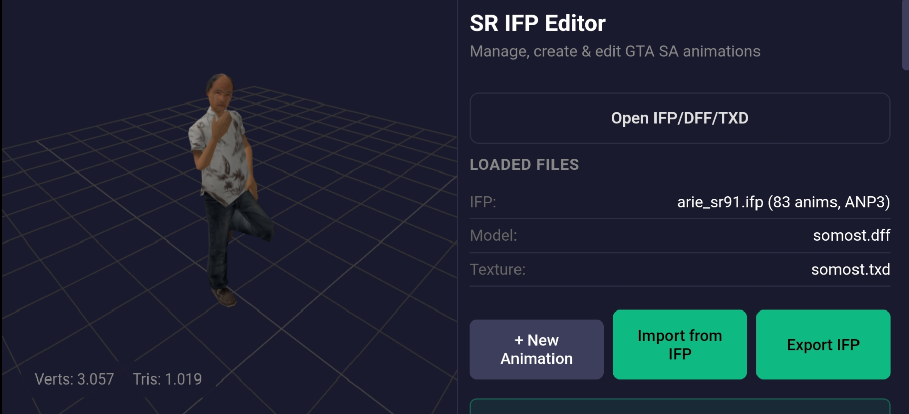

# SR IFP Editor

An Android application for accessing the IFP Editor directly from your Android device, with a native file-saving interface for exporting IFP files.

## Features

- IFP Editor access — Open the IFP Editor in an Android application.
- Native Save File Picker — Choose where to save exported IFP files using Android's file picker.
- Blob URL download support — Handles "blob:" URLs generated by the web editor so exported files can be saved correctly.
- Android integration — Connects the web editor's export process to Android's native file-writing functionality.
- Lightweight application — Uses Android WebView to display the editor instead of bundling a separate browser engine.

## Screenshots



## Download

Download the latest APK from the repository's Releases section.

1. Open the repository on GitHub.
2. Go to Releases.
3. Download the latest APK.
4. Install it on your Android device.

If Android blocks the installation, check the system settings for permission to install apps from your chosen source.

## Build from Source
Requirements
- Java Development Kit (JDK)
- Gradle compatible with the project's Android Gradle Plugin
- Android SDK
- Android SDK Build Tools

## Build Instructions

Clone the repository:

```
git clone https://github.com/ArieSR91/SR-IFP-Editor.git
```

```
cd SR-IFP-Editor
```

Build the debug APK:

```
gradle assembleDebug
```

After a successful build, the APK will normally be located at: 

app/build/outputs/apk/debug/app-debug.apk

How It Works

SR IFP Editor uses Android WebView to display the web-based IFP Editor. When the editor exports a file using a Blob URL, the application reads the generated data and passes it to the Android native layer.

## Important Notes

- The application relies on the web-based IFP Editor hosted by gtastuff.
- An internet connection is required to access the hosted editor.
- This repository contains the Android wrapper and its project files; it does not contain the complete source code or backend of the original GTastuff website.
- Exported files are saved to the destination selected by the user through Android's file picker.

## Disclaimer

SR IFP Editor is an independent Android wrapper project. It is not an official gtastuff application unless explicitly stated by the respective owners.

All trademarks and website content belong to their respective owners.

## License

See the [LICENSE](LICENSE) file for details.
